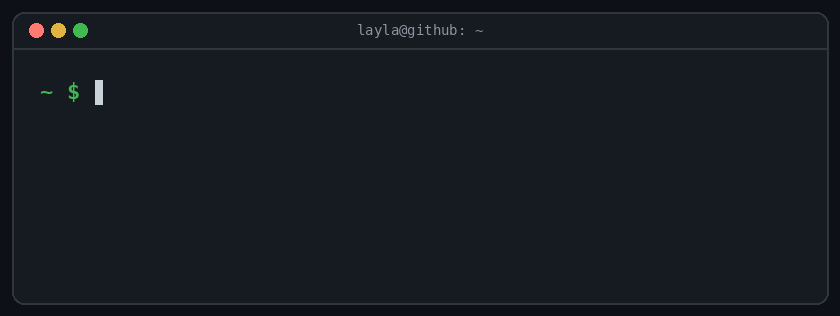

## About Me
💻 Full-stack developer building trading operations software
 
🛠️ Oracle PL/SQL, C# .NET, and React with TypeScript
 
🚢 3 years in commodity trading, covering post-trade physical operations and chartering apps (vessel vetting, voyage operations, emissions/CII, and claims)
 
💊 MSc Pharmacology, University of Bath
 
🔍 Open to new roles in commodity trading tech

**Backend**

**Frontend**

**Testing**

**Tooling**

 
 

<!---->
